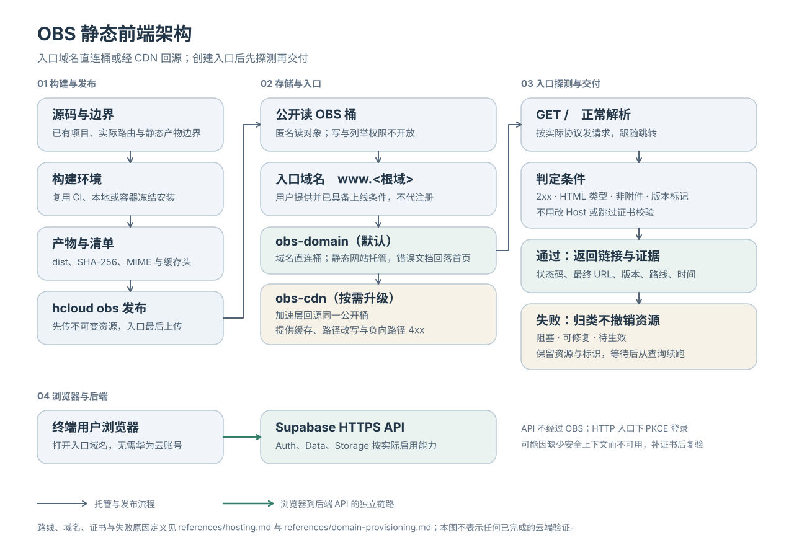

# 华为云前端部署与 Supabase 接入 Skill

通过 AI agent 创建、部署、更新和回退 React/Vue 静态前端，并连接已有华为云 RDS Supabase。支持私有 OBS＋CDN、明确选择的 ECS＋EIP＋Nginx，以及保留或新建用户指定的其他云厂商/平台托管；Cloudflare Pages/Vercel 仅作为具体操作示例。新项目未指定框架时采用 React＋Vite＋TypeScript，也支持普通静态网站和已能静态导出的项目。

## 部署选择与接入流程



[查看完整流程图](docs/deployment-flow.svg) · [编辑文字版 SVG](docs/deployment-flow-editable.svg) · [Excalidraw 结构源文件](docs/deployment-flow.excalidraw)

三种部署场景横向并排，底部共用浏览器访问与 Supabase 接入链路。流程图采用 pastel-handdrawn-diagrams 风格：白底、柔和彩色节点、加粗的规整深色轮廓、直线箭头与手写字体；中文采用 HanziPen SC Bold 手写体，英文保留 Virgil 并合成加粗。展示版 SVG 的中文已转为轮廓，跨设备显示一致；文字可编辑版需本机安装 HanziPen SC Bold。Excalidraw 文件保留结构与标签，其字体回退可能与展示版不同。英文嵌入字体的来源与许可见 [字体说明](docs/diagram-fonts.txt)。

图例：**浅蓝**表示主要托管步骤，**浅橙**表示域名准备，**浅紫**表示其他平台选择，**浅绿**表示浏览器访问、Supabase 接入与验收。工作流已覆盖不等于已在真实云环境部署验收。

- 前端已在其他平台托管时，可以保留现有部署；尚未托管时，也可以选择其他云厂商及其托管服务，按实际能力使用自有域名或平台提供的可用入口。平台选择不限于 Vercel、Cloudflare，也不假设每家都提供免费默认域名。
- 选择华为云且已有可用域名时，使用私有 OBS＋CDN；准备办理域名时，先完成本地构建与预览，待证书及适用备案条件齐备后上线。
- 不准备域名且明确需要公网 IP 访问时，可选择 ECS＋EIP＋Nginx，需要承担服务器维护、带宽费用并处理 HTTPS。**缺少域名不会自动购买 ECS，OBS 桶也不能直接绑定 EIP。**
- 所有路线均由用户浏览器调用已有 Supabase 的 HTTPS API；公开 Key、CORS、登录回调与 RLS 需配置并验收。更新与回退沿用所选路线；未列明的第三方平台按官方文档核实能力，通过已有或新配置的 CI/官方工具发布，能力不足时交付明确缺项。

采用默认 OBS＋CDN 方案时，用户使用自己的域名访问，无需登录华为云；应用登录由 Supabase Auth 处理。SSR、服务端 API 和运行时秘密密钥需要另行明确后端依赖。

## 安装与使用

将 [skills/huawei-supabase-frontend](skills/huawei-supabase-frontend) 整个目录复制或链接到 agent 的 skills 目录，保留 `references` 和 `agents`。从旧版迁移时仅替换确实指向本仓库的安装链接，独立副本先比对再处理。旧 FunctionGraph 版本保留在 Git 历史中。

准备环境、创建并部署、只接入 Supabase、更新和回退共用项目环境记录，不提供独立部署 CLI：

```text
$huawei-supabase-frontend 准备北京四的前端部署环境，连接已有 Supabase，先检查域名和资源费用。
$huawei-supabase-frontend 创建 React 前端并部署到 OBS/CDN，接入已有 Supabase；没有域名时先完成本地预览。
$huawei-supabase-frontend 更新当前应用，复用已有环境并保留上一成功版本。
$huawei-supabase-frontend 回退到指定的已验证版本，刷新页面缓存并检查真实访问。
$huawei-supabase-frontend 不买域名，我明确选择已有 ECS 的公网 IP，用 Nginx 发布静态前端。
$huawei-supabase-frontend 前端已在其他平台，只接入已有华为云 Supabase，保留原托管与发布方式。
$huawei-supabase-frontend 用 Cloudflare Pages 默认域名部署这个项目，并准备更新和回退。
$huawei-supabase-frontend 用我指定的其他云厂商部署，先核实具体托管服务、访问入口、费用和回退能力。
```

华为云资源优先使用官方 KooCLI，OBS 文件用内置 OBS 工具或 obsutil，ECS 站点用 SSH/Nginx；第三方平台优先已有连接器、官方 CLI 或 CI。只接入任务已有可用 Supabase URL/公开 Key 时，不强制配置华为云 CLI。复用已有认证，首次凭证配置与登录通过官方交互完成；秘密不写入聊天、仓库或前端构建产物。

## 首次上线条件

若采用 OBS＋CDN 路线且尚未准备可用域名，首次正式上线需先准备域名。OBS 默认域名可能强制下载网页，不能作为可靠的网页入口，见 [OBS 访问说明](https://support.huaweicloud.com/usermanual-obs/obs_03_0342.html)。缺少域名时交付本地预览、构建产物和上线清单。

中国大陆及全球 CDN 加速要求备案；首次通过华为云备案还有可备案资源条件，见 [备案条件](https://support.huaweicloud.com/icprb-icp/icp_01_0008.html)。注册域名不等于所有条件齐备；skill 不会因缺项自动购买服务器或切换地区。

前端侧以约 300 元/月为费用规划目标，按实际用量估算并设置适用告警；它不是账单硬上限。已有 Supabase 的实例与公网费用独立核算，不自动购买数据库。

## 指引

| 文件 | 内容 |
| --- | --- |
| [SKILL.md](skills/huawei-supabase-frontend/SKILL.md) | 任务入口、边界与工作流 |
| [前端构建](skills/huawei-supabase-frontend/references/frameworks.md) | 静态边界、版本资源和本地验证 |
| [认证](skills/huawei-supabase-frontend/references/authentication.md) | 凭证复用与失败诊断 |
| [区域映射](skills/huawei-supabase-frontend/references/regions.md) | 中国站/国际站名称解析与服务能力核实 |
| [Supabase](skills/huawei-supabase-frontend/references/supabase.md) | 已有应用发现、公开 Key、HTTPS 与权限隔离 |
| [域名与托管](skills/huawei-supabase-frontend/references/hosting.md) | 私有 OBS、CDN、DNS、SPA 路由和费用 |
| [通用记录与验收](skills/huawei-supabase-frontend/references/deployment.md) | 路线标识、兼容旧记录、版本与验收 |
| [OBS 发布与回退](skills/huawei-supabase-frontend/references/obs-release.md) | 对象上传、入口切换、CDN 刷新与恢复 |
| [ECS 发布与回退](skills/huawei-supabase-frontend/references/ecs-hosting.md) | 资源复用/创建、EIP 绑定、Nginx、SSH 发布与恢复 |
| [其他平台](skills/huawei-supabase-frontend/references/external-hosting.md) | 保留或新建指定平台托管、通用发布与回退、Pages/Vercel 示例 |
| [官方资料](skills/huawei-supabase-frontend/references/sources.md) | 来源与核实限制 |

## 验证状态

本仓库交付由 agent 执行的 skill 指引，不是独立部署程序，也不包含用户应用。命令的核对来源及未实测部分见官方资料；当前支持的路线均有准备、发布、更新和回退流程，缺少权限或平台能力时明确停止对应操作。

已执行本地检查：skill 格式、内部引用、shell/JSON 示例、UI 元数据和流程图渲染；在官方 Nginx 1.30.6 容器中通过 20 项测试，覆盖页面路由、负面路径、MIME/缓存、资源先上传、旧资源 URL、更新/回退和错误配置拒绝。独立前向推演覆盖无域名待选择、ECS 发布中断、外部平台无源码/权限、Vercel 发布与回退，并据此修正指引。

- **skill 已完成**：OBS/CDN、ECS/EIP、保留或新建其他云厂商托管的通用工作流（含 Pages/Vercel 示例）及 UI 元数据已同步。
- **本地应用已验证**：不适用，本次未创建应用。
- **环境已准备**：未执行，本次未配置云资源。
- **线上验收通过**：未执行，待域名及环境就绪后验证 HTTPS、路由、登录、隔离、更新和回退。
